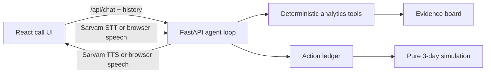

# Snapdeal Virtual KAM

A voice-first Mini AI Virtual KAM for a synthetic seller whose sales dropped. The KAM investigates evidence, proposes one concrete action, waits for explicit seller approval, records a mock execution, and reports a labelled simulated outcome.

## Architecture



All seller, product, competitor, and performance data is synthetic. Marketplace actions are mock operations.

## Demo script

1. Start the app and accept the incoming call.
2. Let the evidence board fill one card at a time from the actual tool results.
3. The KAM proposes a competitor-aligned price and enough stock for 21 days of cover.
4. Say or type `yes, do it`; the latest pending action becomes executed in the ledger.
5. Click `Fast-forward 3 days`; the callback and result strip show a `Simulated 3-day outcome`.
6. Click Replay to hear the latest spoken response again.

The fallback path works without API keys and is the recommended 90-second review path.

## Run locally

```bash
npm install
cp .env.example .env
npm run dev
```

In another terminal:

```bash
python -m venv backend/.venv
source backend/.venv/bin/activate
pip install -r backend/requirements.txt
uvicorn backend.main:app --reload --port 8000
```

For a separate backend port, set `VITE_API_URL=http://localhost:8000/api` before starting Vite. The default production path is same-origin `/api`; `api/index.py` exports the FastAPI app for Vercel.

## Environment variables

- `GROQ_API_KEY`: optional Groq key. Without it, deterministic Python fallback mode is used.
- `GROQ_MODEL`: defaults to `openai/gpt-oss-20b`.
- `SARVAM_API_KEY`: optional Sarvam key for STT and TTS.
- `SARVAM_LANGUAGE`: server fallback language, normally `en-IN`.
- `SARVAM_STT_MODEL`: defaults to `saarika:v2.5`.
- `SARVAM_TTS_MODEL`: defaults to `bulbul:v2`.
- `SARVAM_TTS_SPEAKER`: defaults to the valid `anushka` speaker.
- `DATABASE_URL`: optional SQLAlchemy URL. Local default is SQLite; Vercel's `/tmp` filesystem is not durable.

## AI models and voice technologies used

- Groq OpenAI-compatible API with `openai/gpt-oss-20b` for reasoning and tool calling.
- Sarvam `saarika:v2.5` for speech-to-text, preserving the UI language code.
- Sarvam `bulbul:v2` for text-to-speech.
- Browser Web Speech API as the free speech fallback.
- Deterministic Python analytics for every numeric fact and simulation.

## Design decisions

- Analytics are deterministic and the LLM reasons only over returned tool results. This prevents spoken numbers from being invented by the model.
- Actions require explicit seller approval and only the most recent pending action can execute.
- Outcomes are pure projections from the base synthetic data plus executed actions and are labelled simulated, not measured.
- Synthetic data, mock marketplace actions, and Vercel `/tmp` storage are known limitations. Use a hosted SQLAlchemy-compatible database when durable history is required.

## Tests and build

```bash
python -m unittest discover -s backend/tests
npm run build
```

With a Groq key, the same `/api/chat` request runs the bounded tool-calling loop. The fallback path remains available if Groq times out or is not configured.
