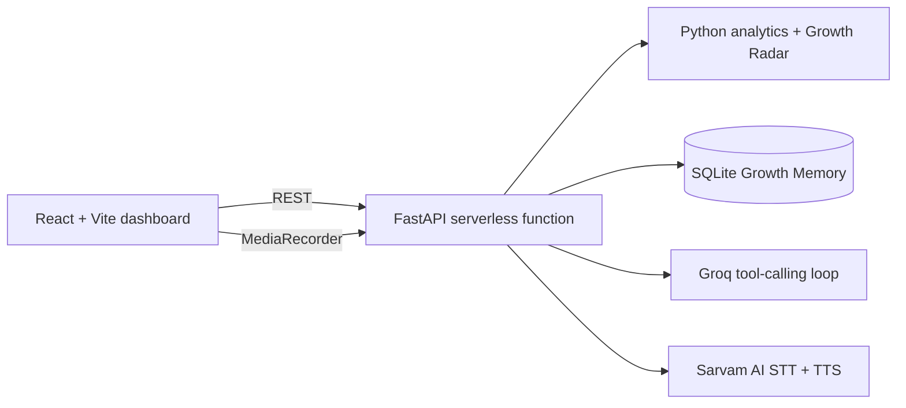

# Snapdeal Virtual KAM

A voice-first seller growth manager MVP for the Snapdeal AI First internship assignment. This is a polished internal demo using clearly synthetic seller data. It diagnoses business changes with deterministic Python analytics, lets a seller model pricing decisions, and records explicitly approved simulated actions.

## Architecture



The Python layer calculates metrics and projections. Groq can call `get_sales_trend`, `get_funnel`, `get_competitor_prices`, `get_inventory`, and `simulate_price_change`; the agent must use returned facts rather than invent numbers. Marketplace actions are mock operations and require an explicit seller approval record before execution.

## Run locally

### Backend

```bash
cd backend
python -m venv .venv
source .venv/bin/activate
pip install -r requirements.txt
cd ..
cp .env.example .env
uvicorn backend.main:app --reload --port 8000
```

### Frontend

```bash
npm install
npm run dev
```

Open http://localhost:5173. Select one of the three synthetic sellers from the selector. The default fashion scenario is designed to demonstrate a 28% decline, lower conversion, a competitor price gap, tight inventory, a price simulation, and an approval request.

## Deploy to Vercel

Import this repository into Vercel and keep the default build settings from `vercel.json`. Vercel serves the Vite build from `dist` and exposes the FastAPI app through `api/index.py`. The frontend uses the same-origin `/api` path in production; no frontend API URL is required.

Set `GROQ_API_KEY`, `SARVAM_API_KEY`, and any other values from `.env.example` in the Vercel project settings. Serverless filesystems are temporary, so the default conversation database is stored in `/tmp` and is not durable. Set `DATABASE_URL` to a hosted SQLAlchemy-compatible database if conversation history must persist. Voice recording is sent to Sarvam AI from the backend, and browser speech synthesis remains a fallback when the Sarvam key or service is unavailable.

## Optional AI and voice setup

Set `GROQ_API_KEY` and keep `GROQ_MODEL=openai/gpt-oss-20b` in `.env`. The core demo keeps a grounded fallback when Groq is unavailable; with a key, `/api/chat` runs a bounded OpenAI-compatible tool-calling loop.

For voice, create a Sarvam AI account and add the free-tier API key as `SARVAM_API_KEY`. The backend uses `saaras:v2` for speech-to-text and `bulbul:v2` with the configured Indian language and speaker for text-to-speech. Change `SARVAM_LANGUAGE` to `hi-IN` for Hindi, or use the language selector in the UI.

## Notes and limitations

- All seller, product, competitor and performance data is synthetic.
- Simulations are directional estimates, not guarantees. They use transparent conversion and margin assumptions.
- The fallback chat asks for the product or category first, then ranks traffic, conversion, price, stock, ratings, and returns from synthetic facts. Groq adds the same diagnosis through tool calls.
- A seller can approve the proposed price and restock plan by voice or text; the approval is stored in the `approvals` table with status `approved`.
- Vercel functions are request-based, so the former local WebSocket acknowledgement endpoint is not included in the deployed API.
- Piper voice model licensing and faster-whisper model licensing should be reviewed before redistribution.
# snapdeal
