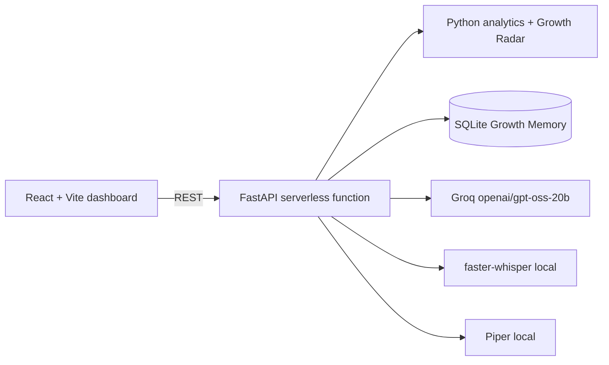

# Snapdeal Virtual KAM

A voice-first seller growth manager MVP for the Snapdeal AI First internship assignment. This is a polished internal demo using clearly synthetic seller data. It diagnoses business changes with deterministic Python analytics, lets a seller model pricing decisions, and records explicitly approved simulated actions.

## Architecture



The Python layer calculates metrics and projections. The LLM is intended to interpret those structured results and hold the conversation; it must never invent numbers. Marketplace actions are mock operations and require an approval record before execution.

## Run locally

### Backend

```bash
cd backend
python -m venv .venv
source .venv/bin/activate
pip install -r requirements.txt
cd ..
cp .env.example .env
uvicorn backend.main:app --reload --port 8000
```

### Frontend

```bash
npm install
npm run dev
```

Open http://localhost:5173. Select one of the three synthetic sellers from the selector. The default fashion scenario is designed to demonstrate a 28% decline, lower conversion, a competitor price gap, tight inventory, a price simulation, and an approval request.

## Deploy to Vercel

Import this repository into Vercel and keep the default build settings from `vercel.json`. Vercel serves the Vite build from `dist` and exposes the FastAPI app through `api/index.py`. The frontend uses the same-origin `/api` path in production; no frontend API URL is required.

Set `GROQ_API_KEY` and any other values from `.env.example` in the Vercel project settings. Serverless filesystems are temporary, so the default conversation database is stored in `/tmp` and is not durable. Set `DATABASE_URL` to a hosted SQLAlchemy-compatible database if conversation history must persist. Local Whisper and Piper speech engines remain optional and are not installed by the root Vercel dependency file; the deployed voice endpoints return their existing fallback response unless those services are provided separately.

## Optional AI and voice setup

Set `GROQ_API_KEY` and keep `GROQ_MODEL=openai/gpt-oss-20b` in `.env`. The current MVP keeps the core demo deterministic when Groq is unavailable; the `/api/chat` boundary is the integration point for structured tool calling with the OpenAI-compatible Groq SDK. For local voice, install `faster-whisper`, download a `base` or `small` model, install Piper, and download the English voice model once:

```bash
mkdir -p ~/.local/share/piper
python -m piper.download_voices --download-dir ~/.local/share/piper en_US-lessac-medium
```

The backend looks for that model in `~/.local/share/piper` by default. Override the location with `PIPER_MODEL_DIR` or select another `.onnx` voice with `PIPER_VOICE`. Audio endpoints validate uploads and report when local models are not installed; no paid speech provider is used.

## Notes and limitations

- All seller, product, competitor and performance data is synthetic.
- Simulations are directional estimates, not guarantees. They use transparent conversion and margin assumptions.
- The current demo chat uses a deterministic context response so the UI remains demonstrable without an API key. Replace that response inside `backend/main.py` with the Groq tool-calling loop when credentials are available.
- Vercel functions are request-based, so the former local WebSocket acknowledgement endpoint is not included in the deployed API.
- Piper voice model licensing and faster-whisper model licensing should be reviewed before redistribution.
# snapdeal
